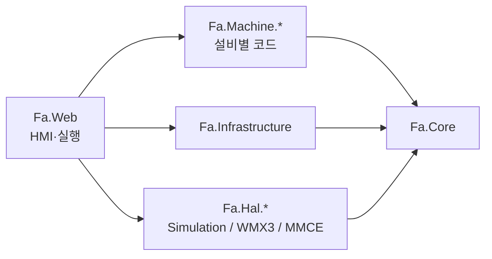
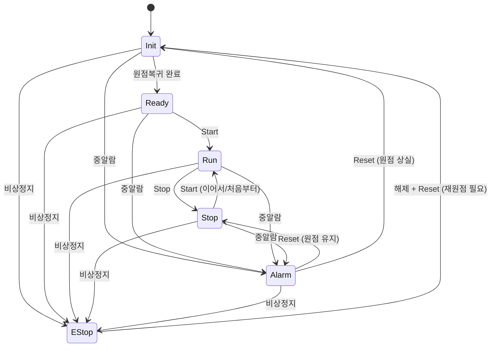

# FA Platform (C# / .NET 8)

FA 설비 제어용 범용 S/W 플랫폼의 **뼈대**입니다. 모션·IO 제어, 시퀀스, 알람, 레시피/티칭, 로그, 사용자 권한, 다국어, 상위통신을 갖추고, 하드웨어 없이 **시뮬레이션 모드**로 바로 돌려볼 수 있습니다.

- 벤더 독립 인터페이스(`IAxis`, `IMotionController`, `IIoController`)와 시뮬레이터를 먼저 만들었고, WMX3 / MMCE 드라이버는 연결 위치만 잡아 둔 상태입니다.
- 축 수와 IO 접점은 `machine.json` 에서 정의하며, 코드에서는 **이름**으로만 참조합니다.
- 예제 설비: 로더 → 반송 → 언로더 (독립 시퀀스 3개, 유닛 간 인터록).

---

## 1. 빠른 실행

```bash
cd FaPlatform
dotnet run --project src/Fa.Web
```

브라우저에서 `http://localhost:5000` 을 엽니다.
메인 화면에서 **Auto → 원점복귀 → 시작** 순서로 누르면 시뮬레이션으로 자동운전이 돌아갑니다.

```bash
dotnet test
```

PostgreSQL 저장소까지 시험하려면 아래처럼 실행합니다 (없으면 해당 시험은 건너뜀).

```bash
FA_TEST_PG="Host=127.0.0.1;Database=fa;Username=fa;Password=fa" dotnet test
```

현장 배포는 `dotnet publish src/Fa.Web -c Release -r win-x64` 결과를 복사합니다. `UseWindowsService()` 가 들어 있어서 Windows 서비스로 등록할 수도 있습니다.

---

## 2. 솔루션 구성

```
FaPlatform
├─ src
│  ├─ Fa.Core              플랫폼 핵심 (외부 의존 없음)
│  │   ├─ Hardware         IAxis, IMotionController, IIoController, MachineConfig(machine.json 모델)
│  │   ├─ Motion           Axis(공통 검사 포함), MotionManager
│  │   ├─ Io               IoManager(프로세스 이미지), DI/DO/AI/AO 접점
│  │   ├─ Alarms           AlarmManager, 알람 정의/이력 모델
│  │   ├─ Machine          MachineController(상태 모델·스레드), InterlockManager, IEquipmentModule
│  │   ├─ Sequence         UnitSequence(유닛 시퀀스 기본 클래스), Handoff(유닛 간 인터페이스)
│  │   ├─ Data             레시피/티칭, 파라미터, 사용자, 다국어, IDataStore
│  │   └─ Common           PeriodicWorker(주기 스레드), OpResult
│  ├─ Fa.Hal.Simulation    가상 축(사다리꼴 프로파일)·가상 IO(출력→입력 링크)
│  ├─ Fa.Hal.Wmx3          Movensys WMX3 드라이버 뼈대 (TODO)
│  ├─ Fa.Hal.Mmce          RS Automation MMCE 드라이버 뼈대 (TODO)
│  ├─ Fa.Infrastructure    JSON 저장소, 텍스트 로그, PostgreSQL/CSV 이력, 상위통신(STX/ETX)
│  ├─ Fa.Machine.Sample    예제 설비 (로더/반송/언로더 시퀀스, 인터록, 알람, 티칭 정의)
│  └─ Fa.Web               ASP.NET Core Blazor Server HMI + 실행 진입점
├─ tests/Fa.Tests          xUnit (상태 전이, 이어서/처음부터, 비상정지, 인터록, 통신 프레이밍, 이력)
└─ db/schema.sql           PostgreSQL 스키마
```

의존 방향은 한쪽으로만 흐릅니다.



- 설비가 바뀌면 `Fa.Machine.*` 프로젝트를 하나 새로 만들고 `Program.cs` 의 `AddFaPlatform<모듈>()` 만 바꿉니다.
- 컨트롤러가 바뀌면 `machine.json` 의 `Controller.Kind` 만 바꿉니다.

---

## 3. 스레드 구조

| 스레드 | 주기 (machine.json `Threads`) | 하는 일 |
|---|---|---|
| IO | `IoScanMs` (2ms) | 입력 이미지 읽기 → 출력 이미지 쓰기 |
| Motion | `MotionScanMs` (2ms) | 모든 축 상태 갱신 (시뮬레이터는 궤적 계산) |
| Supervisor | `SupervisorScanMs` (10ms) | 비상정지, 도어, 서보 알람/리밋 감시, 상태 전이, 타워램프 |
| Seq.{유닛} × N | `SequenceScanMs` (5ms) | 유닛마다 독립 시퀀스 실행 |
| FileLogger | 이벤트 | 로그를 큐에서 꺼내 파일에 쓰기 |
| HistoryWriter | 이벤트 | 알람/사이클 이력을 DB 또는 CSV 에 저장 |

- 모션 컨트롤러 자체의 통신 주기는 컨트롤러 기본값을 그대로 씁니다.
- 시퀀스 스레드는 디스크나 DB 를 직접 건드리지 않고 큐에 넣기만 합니다. DB 가 느리거나 끊겨도 설비는 멈추지 않습니다.
- Windows 에서는 `timeBeginPeriod(1)` 로 1ms 타이머 분해능을 씁니다. 실제 스캔 시간(Last/Max)은 메인 화면에서 확인할 수 있습니다.
- 시작 순서: IO·모션 스레드 → 첫 입력 이미지 확보 → 서보 ON 확인 → 감시·시퀀스 스레드. 첫 입력을 읽기 전에 B접점 비상정지를 오판하지 않기 위한 순서입니다.

---

## 4. 상태 모델과 운전 모드



| 모드 | 동작 |
|---|---|
| Manual | Start 불가. 화면에서 축 조그/이동, IO 출력 조작 |
| Auto | 연속 자동운전 |
| Step | 시퀀스 스텝이 바뀔 때마다 멈추고 `다음 스텝` 버튼을 기다림 (유닛별/전체) |
| DryRun | 자재 없이 동작. 시퀀스의 `Sensor(...)` 로 읽는 자재/진공 센서는 확인을 건너뜀 |
| 원점복귀 | 모드가 아니라 명령 (Init/Ready/Stop 상태에서). 유닛마다 `Home.Order` 순서로 그룹 원점 |

**재시작 정책** (메인 화면에서 Start 할 때 선택, 기본값은 파라미터 `Sequence.DefaultResumePolicy`)

- **이어서 (Continue)**: 멈춘 그 스텝부터 다시 실행합니다. 단, 앞 스텝에서 내린 명령(축 이동, 출력)의 완료를 기다리던 중이었다면 그 명령을 내린 스텝으로 돌아가 명령을 다시 내립니다 (정지 시 축이 감속 정지했으므로).
- **처음부터 (Restart)**: 모든 유닛 Step 0. `SequenceReset` 이벤트로 유닛 간 인터페이스(Handoff)도 초기화합니다. 자재가 설비 안에 남아 있다면 작업자가 먼저 정리해야 합니다.
- 원점복귀 직후 첫 Start 는 항상 처음부터입니다.

---

## 5. 설정 파일

모두 `Data` 폴더(실행 폴더 기준, `appsettings.json` 의 `Fa:DataDirectory`)에 있습니다.

| 파일 | 내용 | 수정 |
|---|---|---|
| `Config/machine.json` | 컨트롤러 종류, 스레드 주기, 축, DI/DO/AI/AO, 안전 입력, 시뮬레이션 링크 | 설비 셋업 시 |
| `Config/alarms.json` | 알람 코드, 등급(Warning/Heavy), 언어별 문구, 조치 방법 | 필요 시 |
| `Config/parameters.json` | 설비 파라미터 값 (파라미터 화면에서 저장) | 화면 |
| `Config/users.json` | 사용자 계정 (PBKDF2 해시) | 사용자 화면 |
| `Recipes/{이름}.json` | 레시피 값 + 티칭 위치 | 레시피/티칭 화면 |
| `Lang/{ko,en}.json` | 화면 문구 | 필요 시 |
| `appsettings.json` (실행 폴더) | 데이터 폴더, 로그, DB 사용 여부, 상위통신 | 설치 시 |

JSON 저장은 임시 파일에 먼저 쓰고 교체하므로 저장 중 전원이 꺼져도 파일이 깨지지 않고, 이전 파일은 `.bak` 으로 남습니다. `machine.json` 처럼 사람이 직접 고치는 파일에는 `//` 주석을 쓸 수 있습니다.

### 축 추가

`Axes` 배열에 한 줄 추가합니다. 시퀀스에서는 `Axis("새이름")` 으로 씁니다.

```json
{ "Name": "LD_T", "AxisNo": 5, "Unit": "deg", "PulsePerUnit": 1000, "MaxVelocity": 360,
  "DefaultVelocity": 180, "DefaultAcc": 1800, "DefaultDec": 1800, "JogVelocity": 10,
  "SoftLimitMin": -180, "SoftLimitMax": 180, "InPositionTolerance": 0.01, "MoveTimeoutMs": 10000,
  "Home": { "Method": "HomeSensor", "Velocity": 10, "Acc": 100, "Offset": 0, "TimeoutMs": 30000, "Order": 1 } }
```

### IO 추가

EtherCAT IO 는 프로세스 이미지의 위치로 정의하므로 IO 제조사와 무관합니다.

- 디지털: `Byte`, `Bit`. B접점은 `Inverted: true` 로 두면 코드에서는 항상 "ON = 동작"으로 읽힙니다.
- 아날로그: `Byte` 오프셋, `DataType` (Int16/UInt16/Int32/Float32), `RawMin/RawMax → EngMin/EngMax` 선형 변환.
- 이미지 크기는 `IoImage.InputSize/OutputSize` 입니다. 실제 위치는 컨트롤러 설정 툴(WMX3 의 EtherCAT 설정 등)에서 확인한 PDO 매핑 주소를 적습니다.

---

## 6. 새 설비 만들기

1. `Fa.Machine.{설비명}` 클래스 라이브러리를 만들고 `Fa.Core` 를 참조합니다.
2. `IEquipmentModule` 을 구현하고 `Configure()` 에서 다음을 등록합니다.
   - 유닛 시퀀스: `m.AddUnit(new XxxSequence(...))`
   - 인터록: `m.Interlocks.AddMotion("축", 목표 => 차단사유 또는 null)`, `AddOutput(...)`
   - 알람 정의 (코드 1000 이상), 레시피 값 정의, 티칭 포인트 정의, 추가 파라미터
3. `Fa.Web/Program.cs` 에서 `builder.AddFaPlatform<새모듈>()` 로 바꿉니다.
4. `Data/Config/machine.json` 을 설비에 맞게 작성합니다.

### 유닛 시퀀스 작성 규칙

`UnitSequence` 를 상속해 `AutoStep()` 에 `switch (Step)` 로 작성합니다. 한 번 호출될 때 **기다리지(Sleep) 않고** 조건이 맞으면 `Next()` 로 넘어갑니다.

```csharp
case 10:
    if (!Sensor(DI("LD_MATERIAL"))) break;                 // 자재 대기 (DryRun 이면 통과)
    if (Move(y, Teach("LD_Y", "Pick"))) Next(11, "Y Pick 이동");
    break;
case 11:
    if (WaitMove(y) && Move(z, Teach("LD_Z", "Down"))) Next(12, "Z Down");
    break;
```

| 도우미 | 설명 |
|---|---|
| `Move(axis, pos)` | 이동 명령. 인터록·소프트리밋 위반 시 알람(106) 후 false |
| `WaitMove(axis)` | 이동 완료 대기. `MoveTimeoutMs` 초과 시 알람(105) |
| `SetOutput(do, on)` | 출력 (출력 인터록 적용) |
| `Sensor(di)` | 센서 확인. DryRun 이면 센서를 보지 않음 |
| `Elapsed(ms)`, `CheckTimeout(ms, code)` | 스텝 경과 시간, 시간 초과 알람 |
| `Fail(code, detail)` | 알람 발생 → 중알람이면 설비 정지 |
| `CycleDone()` | 택타임 기록, 생산 이력 저장, 상위 보고 |
| `HomeAxes`, `OnHomeStart()`, `CanStartHomeGroup()` | 원점 대상 축, 원점 전 안전 동작, 다른 유닛 원점 대기 |

**유닛 간 인터록 (Handoff)**: 자재를 놓을/집을 자리를 가진 쪽(Station)과 들어오는 쪽(Robot)이 상태를 주고받습니다.

```
Station: SetReady() → Robot: BeginTransfer() → (놓기/집기) → Robot: Complete() → Station: Acknowledge()
```

Handoff 가 Idle 이 아니면 Station 축 이동을 막는 인터록을 거는 것이 기본 사용법입니다 (`SampleMachineModule` 참고).

---

## 7. 실제 드라이버 붙이기 (WMX3 / MMCE)

`Fa.Hal.Wmx3/Wmx3Hardware.cs`, `Fa.Hal.Mmce/MmceHardware.cs` 의 `TODO` 위치를 채웁니다.

1. 벤더 SDK 의 .NET DLL 을 프로젝트 참조에 추가하고, csproj 의 `WMX3_SDK` / `MMCE_SDK` 심볼 주석을 풉니다.
2. 구현할 것은 세 가지뿐입니다.
   - `IMotionController.Open/Close/Update` — `Update()` 에서 전체 축 상태를 한 번에 읽어 캐시하면 효율적입니다.
   - `IAxis` — 서보 ON/OFF, 절대/상대 이동, 조그, 정지, 급정지, 원점, 알람 클리어, 상태 읽기.
   - `IIoController.ReadInputs/WriteOutputs` — 프로세스 이미지를 byte 배열로 통째로 주고받습니다.
3. `machine.json` 의 `Controller.Kind` 를 `Wmx3` 또는 `Mmce` 로 바꿉니다.

주석의 WMX3 API 이름은 매뉴얼 기준 예시입니다. 설치된 SDK 버전 문서로 반드시 확인하세요. MMCE 는 함수 이름을 비워 두었습니다.

인터록, 소프트리밋, 원점 여부 검사는 Core 의 `Axis` 가 하므로 드라이버에 넣지 않습니다. MR-J5-G-N1 서보 알람 번호는 `AxisStatus.AlarmCode` 에 넣으면 알람 상세에 표시됩니다.

---

## 8. 상위 통신 (TCP, STX/ETX)

- `appsettings.json` 의 `Fa:HostComm`: `Mode` 는 `Server`(상위가 접속) 또는 `Client`(설비가 접속, 끊기면 재접속). 기본 포트는 7000입니다.
- 프레임: `0x02` + 본문 + `0x03`. 본문은 `명령,인자1,인자2` (UTF-8). 쪼개지거나 붙어서 온 패킷, STX 앞의 쓰레기 바이트도 처리합니다.

| 상위 → 설비 | 응답 |
|---|---|
| `STATUS` | `STATUS,OK,{State},{Mode},{Recipe}` |
| `START[,Continue\|Restart]` | `START,OK` / `START,NG,사유` |
| `STOP`, `RESET`, `HOME` | `…,OK` / `…,NG,사유` |
| `MODE,{Manual\|Auto\|Step\|DryRun}` | `MODE,OK` |
| `RECIPE[,이름]` | 조회 또는 변경 (운전 중 변경 불가) |
| `ALARMS` | `ALARMS,OK,코드:위치;…` |

| 설비 → 상위 (이벤트) |
|---|
| `EVENT,STATE,{State}` |
| `EVENT,CYCLE,{Unit},{Count},{Tact}` |
| `ALARM,SET,{Code},{Source}` / `ALARM,CLEAR,{Code},{Source}` |

명령 추가는 `HostCommandHandler.Register("CMD", args => "CMD,OK")` 로 합니다.

---

## 9. 로그, 알람 이력, DB

- **텍스트 로그**: `Data/Logs/yyyy-MM-dd/{System,Sequence,Alarm,Comm}.txt`. 보관 기간은 `RetentionDays`(기본 90일)이고, 시퀀스 스텝 전환과 사용자 조작(누가 무엇을)이 모두 남습니다. 로그 화면에서 날짜·파일·필터로 볼 수 있습니다.
- **알람**: 발생 중 알람 + 조치 방법, 이력(발생/해제 시각, 소요 시간, 해제자, 레시피), 코드별 통계(횟수, 총 정지시간, 평균 복구시간).
- **DB**: `Fa:Database:Enabled` 가 `true` 이면 PostgreSQL(`fa_alarm_history`, `fa_cycle_history`), `false` 이면 CSV(`Data/AlarmHistory`, `Data/Production`)에 저장합니다. 테이블은 시작할 때 자동으로 만들어집니다 (`db/schema.sql` 과 같은 내용).

---

## 10. 사용자 권한

| 등급 | 할 수 있는 것 |
|---|---|
| Operator (로그인 안 함) | 모드 선택, 시작/정지/리셋/원점, 알람 확인, Step 진행 |
| Engineer | + 수동 조작(축, IO), 티칭, 레시피 편집, 일반 파라미터 |
| Admin | + 안전 관련 파라미터, 계정 관리 |

최초 실행 시 `admin/admin`, `engineer/engineer` 계정이 만들어집니다. 설치 후 반드시 바꾸세요. 파라미터별 편집 권한은 `ParameterDef.EditLevel` 로 정합니다.

---

## 11. 다음 단계 (뼈대 이후 추가할 것)

- [ ] WMX3 / MMCE 실제 드라이버 구현 및 실기 검증 (원점 방식, 기어비, 알람 코드 매핑)
- [ ] 사이클 스톱 (현재 사이클을 마치고 정지)
- [ ] 자재 추적 (유닛별 자재 유무·ID, 처음부터 재시작 시 잔류 자재 확인)
- [ ] 경알람 자동 해제 조건, 알람 발생 시 IO/축 스냅샷 저장
- [ ] 레시피·파라미터 변경 이력 (DB)
- [ ] 화면 접속 보안 (HTTPS, 접속 IP 제한, 세션 타임아웃 자동 로그아웃)
- [ ] 화면별 다국어 키 확장 (현재는 메뉴·주요 버튼 위주)
- [ ] 보간 이동, 갠트리, 속도 프로파일(S-커브) 등 모션 기능 확장
