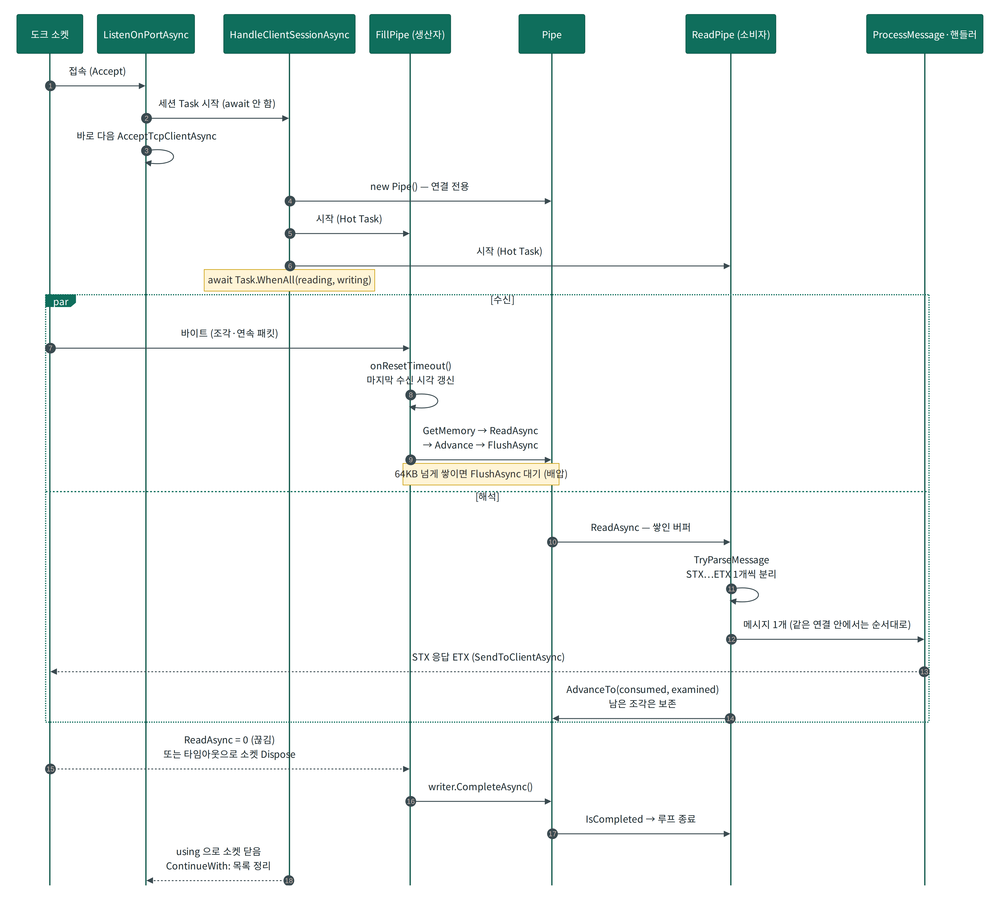
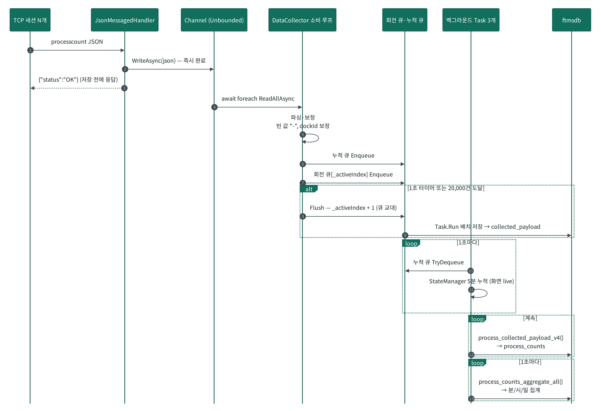
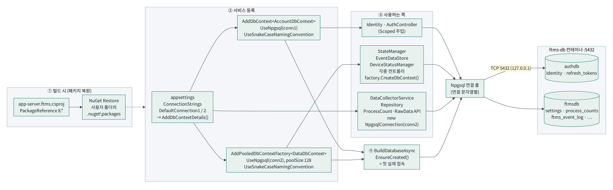

# app-server.ftms / DxfBlazorViewer.Client 주요 클래스·함수 설명서

> 대상: `servers/ftms/app-server.ftms` (서버), `servers/ftms/DxfBlazorViewer` (웹 UI, Blazor WASM)
> 기준: 원본 `CJ.SCADA.Solution.zip` 소스. 행 번호는 원본 기준 **근사값**(수정하면 달라짐)
> 표기: ★ 수정·디버깅 시 먼저 볼 것 · ⚠ 주의 · (Sx/Bx) = [01 최종 분석 보고서](01_CJ.SCADA-최종분석보고서.md) §7 항목 번호
> 관련: [03 부록 REST API](03_부록-REST-API.md) · 도크 끊김 수정 패치 `setup/patches/dock-offline/`
> 빌드 제외 파일(읽지 말 것): `Controllers/AssetsController/**`, `TcpClient-NA/*`, `TcpServer/TcpClientFinalService.cs`, `* - Copy.cs`, 클라이언트 `DxfSkiaRendererFast_v1~v3.cs`, `* - 복사본.*`, `Viewer_v1/v2.razor`

---

## 목차
- [A. app-server.ftms](#a-app-serverftms)
  - A0 기동 순서 · A1 TCP 통신 · A2 상태 관리 · A3 수집·집계 · A4 REST API · A5 실시간(SignalR) · A6 DB·기반
- [B. DxfBlazorViewer.Client](#b-dxfblazorviewerclient)
  - B0 구성·DI · B1 앱 셸·로그인 · B2 SignalR 클라이언트 · B3 Viewer · B4 DXF 렌더러 · B5 도면 다운로드 · B6 페이지 · B7 유틸
- [C. 공통 주의사항 요약](#c-공통-주의사항-요약)

---

# A. app-server.ftms

## A0. 기동 순서 — `Program.cs`, `Program.Extensions.cs`

```
WebApplication.CreateBuilder
 ├ AspNetCore.InitializeLogger()            Serilog (콘솔 + bin\Debug\logs\app-server.ftms-YYYYMMDD.txt, 14일)
 ├ builder.ConfigurationForwardedHeaders()  X-Forwarded-* (프록시 뒤)
 ├ builder.ConfigureKestrelFromCustomConfig()  UseCustomKestrelKestrel=Yes 일 때만 (기본 No → launchSettings 주소 사용)
 ├ builder.AddDbContextDetails()            AccountDbContext / DataDbContext (Npgsql + snake_case)
 ├ builder.AddIdentityServices()            Identity + JWT + 권한 Policy
 ├ builder.AddSwaggerDetails() / AddWebSocketChatHubSignalR()
 ├ builder.AddTcpServerServiceAndManager()  TcpServerFinalService, 핸들러 자동 등록, 연결 관리자
 └ builder.AddMyOwnBusinessLogicServices()  StateManager, DataCollector, EventDataStore, DeviceStatusManager …
app = builder.Build()
 ├ await app.BuildDatabaseAsync()           EnsureCreated(authdb, ftmsdb) + Role/기본계정 시드
 ├ await app.WriteDefaultToDbAsync()        .default.settings/*.json·tsv → DB, 처리 후 파일 이동
 ├ app.MapDefineCommands()                  IApiCommand → /api/{Name} 자동 매핑
 ├ UseRouting / UseCors / UseAuthentication / UseAuthorization / MapControllers / MapHub<ChatHub>("/chathub")
 └ app.Run()  → 등록된 HostedService 들의 StartAsync 순차 실행 → 그다음 Kestrel 이 8121 대기 시작
```

**`ConfigurationHelper` (전역 static 클래스, 확장 메서드 모음)**

| 함수 | 역할 | 주의 |
|---|---|---|
| `AddDbContextDetails(this WebApplicationBuilder)` | 연결 문자열 `DefaultConnection1/2` 로 두 DbContext 등록 | ⚠ 연결 문자열(비밀번호 포함)을 Information 로그로 출력 (S10) |
| `AddIdentityServices` | Identity, 비밀번호 정책(최소 4자, 조합 규칙 없음), JWT Bearer, Policy | 정책이 약함 (S3), CORS 전체 허용 + Credentials (S5) |
| `AddTcpServerServiceAndManager` | `TcpServerFinalService`(HostedService), `ITcpMessageHandler` 구현체 리플렉션 등록 | 핸들러는 `Priority` 순 정렬 |
| `AddMyOwnBusinessLogicServices` | `DeviceStatusManager` 싱글턴 → `LogisticsSystemStateManager` 싱글턴 + HostedService 이중 등록 | 같은 인스턴스를 두 역할로 사용 (의도된 구조) |
| ★ `BuildDatabaseAsync(this WebApplication)` | `EnsureCreated` ×2, Role 7개, `IdentityDataSeeder.SeedDefaultUsersAsync` | ⚠ DB 미연결이면 여기서 막혀 **8121 이 열리지 않음** (B12). `EnsureCreated` 는 테이블이 하나라도 있으면 아무것도 안 만듦 |
| `WriteDefaultToDbAsync` | `.default.settings` 의 설정 json, `ftms_event_list.tsv` 를 DB 반영 | ⚠ 처리 후 파일을 타임스탬프 폴더로 이동 → 재배포 시 파일이 사라진 것처럼 보임 |
| `MapDefineCommands` | `ApiCommandFinder` 로 `IApiCommand` 구현을 찾아 `EndpointMapper` 로 매핑 | `Activator.CreateInstance` 생성 → **DI 불가** |

> 확장 메서드 원리: `this WebApplication app` 매개변수 때문에 `app.BuildDatabaseAsync()` 가 컴파일 시 `ConfigurationHelper.BuildDatabaseAsync(app)` 로 바뀜.

⚠ `Program.cs` 하단의 `Host.CreateDefaultBuilder … UseUrls("http://*:5000")` 블록은 **미사용 레거시**.

---

## A1. TCP 통신 (도크 ↔ 서버)

### ★ `TcpServerFinalService` — `TcpServer/TcpServerFinalService.cs`
`TcpServerServiceBase<TcpServerConfig>` 상속, BackgroundService. 설정 섹션 `TcpServerFinal` (`IpAddress`, `Ports`[6004,6005,6006], `StartDelimiter` STX, `EndDelimiter` ETX, `TimeoutSeconds` 10).

| 함수 | 역할 | 특징 / 주의 |
|---|---|---|
| 생성자 | 설정 로드, 핸들러를 `Priority` 오름차순 정렬, `DataCollectorChannel` Writer 보관 | DEBUG 에서 핸들러 순서 로그 |
| `ExecuteAsync` | 포트마다 `ListenOnPortAsync` + `CheckClientTimeoutsAsync` 동시 실행 | 설정 오류면 Critical 로그 후 종료 |
| ★ `ListenOnPortAsync(ip, port)` | `AcceptTcpClientAsync` 루프. `clientId = RemoteEndPoint("IP:Port")`, 연결 관리자 등록, **세션 Task 를 await 하지 않고 시작** 후 즉시 다음 Accept | 다수 클라이언트 동시 처리의 핵심. 세션 종료 시 `ContinueWith` 에서 목록 정리 |
| `CheckClientTimeoutsAsync` | 5초마다 마지막 수신 시각 검사, `TimeoutSeconds` 초과 연결 `Dispose` | 실제 끊김 감지는 최대 Timeout+5초 |
| ★ `HandleClientSessionAsync(clientId, client)` | 연결 전용 `Pipe` 생성, `FillPipeAsync`(수신) + `ReadPipeAsync`(해석) 동시 실행 | 한 연결의 메시지는 **순서대로**, 연결끼리는 **병렬** |
| `ProcessMessageAsync` | 바이트 → UTF-8 문자열, 클라이언트별 로그레벨이 Information 이하면 송수신 로그 | 로그레벨은 `RuntimeConfigChange` API 로 변경 |
| `ProcessTcpCommandAsync` | 정렬된 핸들러 중 `CanHandle` 이 참인 첫 핸들러의 `HandleAsync` 실행 | 해당 없으면 `"Unknown command: …"` 응답 |

⚠ 연결 종료 시 접속 목록만 정리하고 **도크 상태는 그대로** → 화면이 마지막 상태 유지 (B17, 패치 있음).
⚠ 메시지 최대 길이 제한 없음 (B11), TCP 무인증·평문 (S7).

### `TcpServerServiceBase<TConfig>` — `TcpServer/TcpServerServiceBase.cs`
| 함수 | 역할 |
|---|---|
| `FillPipeAsync(clientId, stream, writer, onResetTimeout)` | `stream.ReadAsync` → `writer.Advance` → `FlushAsync`. 수신할 때마다 `onResetTimeout` 으로 타임아웃 시각 갱신 |
| `ReadPipeAsync(clientId, reader, processMessageFunc)` | `ProtocolParser.TryParseMessage` 로 STX…ETX 완성 메시지만 추출, 남은 부분은 `AdvanceTo` 로 보존 |

특징: System.IO.Pipelines 사용 → 부분 패킷·연속 패킷을 정확히 처리, 연결당 스레드 없이 async I/O(IOCP) 로 소수 스레드가 처리.

### `TcpServerConnectionManager` — `TcpConnectionManager/TcpServerConnectionManager.cs`
`ConcurrentDictionary<clientId, ClientInfo{TcpClient, Nickname, LogLevel, AcceptedAt}>`

| 함수 | 역할 | 주의 |
|---|---|---|
| `AddClient` / `RemoveClient` | 연결 등록/삭제 | |
| `AddOrUpdateClientNickname(clientId, nickname)` | **IP:Port ↔ DockId** 연결 (heartbeat 처리 시 `JsonMessagedHandler` 가 호출) | heartbeat 를 한 번도 안 보낸 연결은 닉네임 없음 |
| `GetLogLevel` / `SetLogLevel` | 클라이언트별 로그레벨, `IMemoryCache` 캐시 | 변경 시 캐시 키 `logLevel-{clientId}` 제거 |
| `GetConnectedClientEndpoints()` | (nickname, localEp, remoteEp, logLevel, acceptedAt) 목록 | `/health`, 관리자 화면에서 사용 |
| `SendToClientAsync(clientId, message)` | 구분자를 붙여 해당 연결에 전송 | 연결이 끊겨 있으면 목록에서 제거 후 false |

### TCP 메시지 핸들러 — `TcpMessageHandlers/`
계약 `ITcpMessageHandler { Priority; CanHandle(msg, out cmd); HandleAsync(clientId, cmd, msg, channelWriter) }` — 구현체는 리플렉션으로 자동 DI 등록.

| 클래스 (Priority) | 처리 | 주의 |
|---|---|---|
| `PingCommandHandler` (0) | `ping` → `pong` | |
| `ApiDockStatusCommandHandler` (5) | 문자열 `/api/dock/status` | ⚠ `GetAllStatusAsync()` **await 누락** → Task 객체가 직렬화됨 (B4) |
| ★ `JsonMessagedHandler` (100) | JSON `type` 분기: `process_count` → `DataCollectorChannel` 에 넣고 OK, `heartbeat` → StateManager 응답 생성 + `DeviceStatusManager` 알람 처리 + 닉네임 등록, `dock_sorting_param`, `request_time` | ⚠ `type` 값 대소문자 구분 (B14), `WriteAsync` 미await (B5). 키 검색은 `TryGetPropertyIgnoreCase` 로 대소문자 무시 |

### ★ 세션 처리 상세 — Hot Task 와 Pipe

**① 리스너 시작: async 메서드는 호출하는 순간 실행된다 (`ExecuteAsync`)**

```csharp
var runningTasks = Config.Ports.Select(port => ListenOnPortAsync(ipAddress, port, stoppingToken)).ToList();
runningTasks.Add(CheckClientTimeoutsAsync(stoppingToken));
await Task.WhenAll(runningTasks);
```

- `Select` 는 지연 실행이라 이 시점에는 아무것도 호출하지 않습니다. **`ToList()` 가 목록을 꺼내면서 `ListenOnPortAsync` 를 포트 수만큼 호출**합니다.
- 각 호출은 `listener.Start()` 와 로그 출력을 호출한 스레드에서 바로 실행합니다. 그다음 `await AcceptTcpClientAsync()` 에서 미완료 `Task` 를 돌려주고 복귀합니다. 이렇게 호출 즉시 시작되는 Task 를 "Hot Task"라고 합니다.
- 그래서 `ToList()` 가 끝나면 세 포트가 모두 이미 Listen 중입니다. `Task.Run` 이나 전용 스레드는 쓰지 않고, 기다리는 동안 점유하는 스레드는 0개입니다(async I/O).
- `Task.WhenAll` 은 Task 를 **실행시키는 코드가 아니라** 모두 끝날 때까지 `ExecuteAsync` 를 기다리게 하는 코드입니다.
- ⚠ `ToList()` 없이 시퀀스를 두 번 열거하면 리스너가 두 번 만들어져 "포트 사용 중" 오류가 납니다.
- ⚠ 포트 하나의 `Start()` 가 실패하면 `catch` 에서 로그만 남기고 그 Task 만 끝납니다. 서버는 계속 돌기 때문에, 시작 로그에서 `Listening on …:6004/6005/6006` 이 모두 찍혔는지 확인해야 합니다. Accept 루프에서 예외가 나도 그 포트는 다시 열리지 않습니다.

**② `HandleClientSessionAsync` — 연결 1개 = Pipe 1개 + Task 2개**

```csharp
using (client)                                               // 세션이 끝나면 소켓 자동 종료
{
    var pipe    = new Pipe();                                // 이 연결 전용 바이트 버퍼
    var writing = FillPipeAsync(clientId, client.GetStream(), pipe.Writer, onResetTimeout, ct);   // 소켓 → Pipe
    var reading = ReadPipeAsync(clientId, pipe.Reader, m => ProcessMessageAsync(clientId, m, client, ct), ct); // Pipe → 메시지
    await Task.WhenAll(reading, writing);
}
```

| 단계 | 함수 | 하는 일 |
|---|---|---|
| 생산자 | `FillPipeAsync` | `writer.GetMemory()` 로 Pipe 메모리를 빌려 `stream.ReadAsync` 로 **복사 없이** 바로 받음 → `onResetTimeout()`(마지막 수신 시각 갱신) → `Advance(n)` → `FlushAsync()`. `ReadAsync` 가 0 이면(상대가 끊음) 루프를 끝내고 `writer.CompleteAsync()` |
| 소비자 | `ReadPipeAsync` | `reader.ReadAsync()` 로 쌓인 버퍼 전체를 받아 `ProtocolParser.TryParseMessage` 로 STX…ETX 를 하나씩 잘라 처리 → `AdvanceTo(buffer.Start, buffer.End)` → 생산자가 Complete 하면 종료 |
| 처리 | `ProcessMessageAsync` | UTF-8 문자열 변환 → 핸들러 선택·실행 → `SendToClientAsync` 로 `STX+응답+ETX` 를 같은 소켓에 전송 |

- **`AdvanceTo(consumed, examined)`**
  - `consumed`(처리를 끝낸 위치) 앞의 메모리는 Pipe 가 회수합니다.
  - `examined` 를 버퍼 끝으로 주면, 다음 `ReadAsync` 는 **새 바이트가 올 때까지 대기**합니다. 같은 데이터를 계속 다시 읽는 무한 루프가 생기지 않습니다.
  - 아직 ETX 가 오지 않은 조각은 남겨 두었다가 다음 데이터와 이어 붙입니다.
- **Pipe 를 쓰는 이유**: TCP 는 메시지 경계가 없어서 프레임 하나가 쪼개져 오거나 여러 개가 붙어서 옵니다. Pipe 가 조각 보관과 메모리 풀링을 맡으므로, 직접 버퍼를 이어 붙이는 코드가 필요 없습니다.
- **배압**: Pipe 에 64KB(기본값) 이상 쌓이면 `FlushAsync` 가 대기합니다. 그러면 소켓 읽기가 멈추고, TCP 흐름 제어로 도크의 송신도 느려집니다.
- **순서**: 한 연결 안의 메시지는 순서대로 처리되고, 서로 다른 연결끼리는 병렬로 처리됩니다.
- **종료**: 상대가 끊거나(`ReadAsync`=0), 타임아웃 검사가 소켓을 `Dispose` 하거나, 서버가 종료되면(`ct` 취소) 끝납니다. 그 뒤 `using` 이 소켓을 닫고, `ListenOnPortAsync` 의 `ContinueWith` 가 `_clientTasks`·`_lastReceiveTimes`·연결 관리자에서 해당 연결을 지웁니다.
- ⚠ 응답 전송이 처리 루프 안에 있어, 소켓 쓰기가 막히면 같은 연결의 다음 메시지 처리도 멈춥니다(다른 연결에는 영향 없음).
- ⚠ `FillPipeAsync` 가 `ArrayPool` 에서 버퍼를 빌리지만 쓰지 않고, `ReadPipeAsync` 는 `reader.CompleteAsync()` 를 호출하지 않습니다(동작에는 영향 없음).



---

## A2. 상태 관리

### ★ `LogisticsSystemStateManager` — `Managers/LogisticsSystemStateManager.cs` (1,024줄)
싱글턴 + BackgroundService. 시스템 "현재 상태"의 중심. 실제 데이터는 `EventDataStoreService` 에 타입별로 보관.

| 함수 | 역할 | 특징 / 주의 |
|---|---|---|
| `StartAsync` | ① 이벤트 저장 테이블 생성 ② `RestoreAsync` 로 파라미터셋·활성파라미터·Heartbeat·누적수량 복원 ③ `settings` 테이블에서 분류 파라미터 로드 | ⚠ ① 실패 시 `throw` → 호스트 기동 실패 (B12). ⚠ ② 복원은 **`event_data_store` 테이블을 읽는데 저장은 `dock_message_events`** → 실제로 복원 안 됨 (B15) |
| `ExecuteAsync` | `AssetItemUpdateChannel` 을 계속 읽어 `DispatchSettingChannelMessageAsync` 호출 | 웹 설정 변경 → 메모리 반영 경로 |
| `DispatchSettingChannelMessageAsync` | `Setting` 의 Category 로 분기: 파라미터셋(`DockSortParamSetKey`) / 도크 활성 파라미터(`DockSortParamKey1` + Key `DockSortParamKey2`) 를 메모리 갱신 | 역직렬화 실패는 빈 catch 로 무시 |
| `GetDockSortingCurrParam<T>(category, key, machineId)` | `settings` 테이블에서 JsonValue 조회·역직렬화 | |
| ★ `AccumProcessCountFromClientAsync(pc)` | 도크별 **최근 N분(기본 5, DEBUG 1) 슬라이딩 누적**: 리스트 앞에 추가, 오래된 항목은 누적에서 빼고 제거 | `ProcessCountL` 의 `+`/`-` 연산자 사용. ⚠ 예외를 `throw` 로 재던짐 |
| `RemoveTimeoutProcessCountsAsync` | 1초마다 만료 항목 제거·누적 차감 | ⚠ "누적 초기화" 로그와 달리 실제 초기화 안 함 (B9). 로그는 100회/1분 단위로 제한 |
| `UpdateProcessCountFromClientAsync` | 도크가 보낸 누적값 그대로 저장 (현재 경로에서 미사용) | |
| `GetProcessCountsAsync(dockIds)` | 메모리 누적값 조회 → `/api/ProcessCount/live/latest-n-minutes` | ⚠ 가변 객체 그대로 반환 (B10) |
| `GetAllStatusAsync(dockIds)` | 마지막 Heartbeat 목록 → `/api/Dock/status` | ⚠ 끊긴 도크도 그대로 포함, 시각 검사 없음 (B17) |
| `SanitizeStatusString_v2(deviceType, status)` | 장치 상태 문자열 정규화: Conveyor 는 `CS` + 2바이트씩 숫자, 그 외는 2글자 hex → `"0001,00a0,…"` | `_v1` 은 이전 버전 |
| ★ `GetResponseHeartbeatMessageAsync(message)` | Heartbeat 역직렬화 → 상태 정규화 → 저장(`saveToDb:true`) → 도크 활성 파라미터(없으면 `"Default"`) 를 담은 응답 생성. 반환 `(dockId, 응답JSON)` | ⚠ `"Default"` 공유 객체의 `DockId` 를 직접 수정 → 동시 세션에서 오염 (B3) |
| `GetResponseDockSortingParamMessageAsync` | 도크가 요청한 분류 파라미터셋 응답 | 없으면 `"Default"` 셋 |
| `Add/Clear/GetCollectedPayloadProcessingResult…` | 수집 처리 결과(Loaded/Deduped/Inserted/Updated/Error) 60분 누적 → SignalR 로 화면 상단 표시 | `lock` 으로 보호. ⚠ 키가 `DateTimeOffset.UtcNow` 라 같은 시각 결과는 덮어써져 누적과 불일치 가능 |

### ★ `EventDataStoreService<TKey>` — `Services/EventDataStoreService.cs`
"타입명 → (키 → 최신 객체)" 2단 인메모리 저장소 + 선택적 DB 영속화.

| 함수 | 역할 | 주의 |
|---|---|---|
| 생성자 | `flushIntervalSeconds`=10, `maintenanceIntervalSeconds`=60 타이머 시작 | ⚠ `new Timer(async _ => …)` = async void → 예외 시 프로세스 종료 위험 (B1) |
| `GetAsync<T>()` | `_data_in_mem[typeof(T).Name]` 반환 | ⚠ **내부 딕셔너리 그대로** 반환 (복사본 아님, B10). 키가 `typeof(T).Name` 이라 `List<A>`·`List<B>` 충돌 |
| `UpdateAsync<T>(key, value, version, saveToDb)` | 메모리에 덮어쓰기, `saveToDb` 면 DB 버퍼에도 | 지우는 메서드는 없음 |
| `FlushAsync` | 10초마다 버퍼 → `InsertAsync` → `dock_message_events` | ⚠ 실패해도 버퍼 `Clear()` → 유실 (B2) |
| `InsertAsync` | 한 트랜잭션으로 벌크 INSERT | |
| `RestoreAsync<T>` | 기동 시 키별 최신 1건 복원 | ⚠ `event_data_store` 를 읽음 → 저장 테이블과 불일치 (B15) |
| `DeleteOldEventsAsync` | 60초마다 키별 최신 1건 외 삭제 | ⚠ `event_data_store` 대상, 실패 시 `throw` (B1). DB 장애 시 `Failed to delete old events` 로그 |
| `EnsureTablesCreatedAsync` | `event_data_store` 테이블·인덱스 생성 | |

### `DeviceStatusManager` (+ `DeviceTypeStore`, `DeviceStatusManagerInitializer`) — `Managers/`
| 함수 | 역할 | 주의 |
|---|---|---|
| `InitializeLoadEventMasterCacheAsync` | 기동 시 `ftms_event_list` 마스터 캐시 (Initializer HostedService 가 호출) | 마스터 변경 후 재시작해야 반영 |
| ★ `ProcessHeartbeatMessageAsync(dockId)` | 저장된 Heartbeat 의 장치별 상태코드 배열을 장치유형(`DeviceTypeEnum`)별로 처리 | |
| `DetectStatusChanges` / `DeviceTypeStore.DetectDeviceStatusChange` | 인덱스별 이전 값과 비교 → `StatusChange` 목록 | ⚠ 이전 상태가 메모리에만 있어 **재시작 직후 전부 "신규"로 기록** |
| `UpdateDbDeviceStatusChangeEventLog` | 변경마다 마스터(DeviceType+SubCode) 매칭 → `ftms_event_log` 일괄 INSERT. 설명 형식 `[B23:Conveyor:0] \t새상태 [0x0001]\t(이전상태: … )` | 마스터에 없으면 `E_UNKNOWN`/Error |
| `ConvertHexStringToIntegers` | `"0001,00a0"` → 정수 목록 | |

---

## A3. 수집·집계

### ★ `DataCollectorService` — `Services/DataCollectorService.cs`
BackgroundService. `DataCollectorChannel`(Unbounded, 단일 소비자) 소비. 설정 `DataCollectConfig { FlushThreshold=20000, FlushIntervalMs=1000 }`.

| 함수 | 역할 | 주의 |
|---|---|---|
| 생성자 | 연결 문자열 `DefaultConnection2`, `CollectedPayloadRepository` 생성, 10개 회전 큐 | ⚠ `InitializeAsync()`(테이블·함수 생성) fire-and-forget (B7). ⚠ 설정 섹션 키가 `Constants.DataCollectorChannelId`(GUID 포함 문자열)라 appsettings 에서 사실상 설정 불가 → 항상 기본값 |
| ★ `ExecuteAsync` | 루프 3개 시작 + 채널 수신: `process_count` 메시지 보정(빈 값 `-`, DockId←ClientId/RawData) → ① 누적 큐 ② 회전 큐(임계치 도달 시 즉시 `Flush`) | 처리 대상은 `ProcessCounts[0]`(이번 건)만 |
| `ProcessAggregationBufferAsync` | 1초마다 `RemoveTimeoutProcessCountsAsync` → 누적 큐 비우며 `AccumProcessCountFromClientAsync` | 두 작업을 같은 루프에서 순서대로 → 경합 없음 |
| `Flush` / `StoreCollectedPayloadBatchAsync` | 활성 큐 인덱스 회전 후 배치를 CSV 텍스트로 `collected_payload` INSERT | `Interlocked` 로 중복 Flush 방지. ⚠ `StopAsync` 에서 마지막 배치 유실 가능 (B8) |
| `UpsertBulkCollectedPayloadToRawCountDb` | `process_collected_payload_v4()` 반복 호출(batchSize 1) → 결과 누적 → SignalR `CollectedCountReceived` | ⚠ `PreciseSleeper.Sleep(10)`(동기 대기)로 스레드풀 스레드 1개를 계속 점유 |
| ★ `CallAggregationDbProcedureContinuouslyAsync` | 1초마다 `process_counts_aggregate_all(20000)` → 분/시/일 집계 | ⚠ try/catch 없음 → **DB 오류 1회로 집계 영구 정지** (B6). 함수는 앱이 만들지 않음(가이드 9단계) |
| `MoveCollectedFilesTempToArchiveDir`, `SimulateTcpReceive` | SQLite 임시파일 방식(조건부 컴파일), 시뮬레이션 | 현재 미사용 |

### 저장소 (Assembies/Assembly.Data.Collector)
| 클래스 | 역할 |
|---|---|
| `CollectedPayloadRepository` | `collected_payload`·`rawdata_table` 하이퍼테이블과 `process_collected_payload_v4()` **생성 SQL 내장**, 처리·재시도(최대 5회)·Dead-letter |
| `ProcessCountRepository` | `ExecuteAggregationWithResultAsync`(집계 함수 호출), COPY 기반 Bulk Upsert, `pg_read_file` 경로(미사용) |

### ★ Channel 기반 수집 흐름 — 수신과 DB 저장 분리

**Pipe 와 Channel 비교**

| | `System.IO.Pipelines.Pipe` | `System.Threading.Channels.Channel<T>` |
|---|---|---|
| 담는 것 | 바이트 흐름 (경계 없음) | 객체 단위 (항목 1개 = 메시지 1개) |
| 용도 | 소켓 수신 바이트 → 프레임 분리 | 처리수량 JSON → 수집 서비스로 전달 |
| 개수 | 연결마다 1개 | 서버 전체 1개 (Singleton) |
| 생산자 : 소비자 | 1 : 1 | **N(모든 TCP 세션) : 1(DataCollectorService)** |
| 배압 | 기본 64KB 에서 대기 | Unbounded 라서 대기 없음 |

**정의와 등록** — `Channels/DataCollectorChannel.cs`, `Program.Extensions.cs`

```csharp
Instance = Channel.CreateUnbounded<string>(new UnboundedChannelOptions {
    SingleReader = true,                  // 소비자 1개 → 내부 동기화 최적화
    SingleWriter = false,                 // 여러 세션이 동시에 씀
    AllowSynchronousContinuations = false // 쓰는 스레드(TCP 세션)가 소비자 코드를 대신 실행하지 않음
});
builder.Services.AddSingleton<DataCollectorChannel>();   // 같은 인스턴스를 양쪽에 주입
```

- 쓰는 쪽(`TcpServerFinalService`)은 `.Writer` 만, 읽는 쪽(`DataCollectorService`)은 `.Reader` 만 받습니다. 두 서비스는 서로를 모르고 Channel 만 공유합니다.
- `Channel<string>` 을 그대로 등록하지 않고 클래스로 감싼 이유는 DI 에서 용도별로 구분하기 위해서입니다. 설정 변경용 `AssetItemUpdateChannel` 도 같은 방식입니다.

**쓰는 쪽** — `JsonMessagedHandler` (`processcount`)

```csharp
try { channelWriter?.WriteAsync(message); } catch { }               // JSON 원문을 그대로 넣음
responseMessage = Json.Serialize(new { status = "OK", time = ... }); // 저장 결과와 상관없이 즉시 OK
```

- Unbounded 라서 `WriteAsync` 는 항상 즉시 완료됩니다. 의도를 분명히 하려면 `TryWrite(message)` 가 적절합니다.
- **"OK" 는 '받았다'는 뜻이지 'DB 에 저장했다'는 뜻이 아닙니다.**

**읽는 쪽** — `DataCollectorService.ExecuteAsync`

```csharp
_flushTimer = new Timer(_ => Flush(), null, 1000, 1000);                   // 1초마다 Flush
var tasks = new[] {                                                         // 백그라운드 3개
    Task.Run(() => ProcessAggregationBufferAsync(ct)),                      // 1초: 5분 누적(메모리)
    Task.Run(() => UpsertBulkCollectedPayloadToRawCountDb(ct)),             // collected_payload → process_counts
    Task.Run(() => CallAggregationDbProcedureContinuouslyAsync(ct, 1)) };   // 1초: 분/시/일 집계
await foreach (var json in _channelReader.ReadAllAsync(ct))                 // 비어 있으면 스레드 점유 없이 대기
{
    // 파싱 → processCounts[0] → 빈 값 "-" → dockId 보정 → rawData 문자열화
    _queueForBufferUpdate.Enqueue(item);                                    // → 5분 누적
    _queuesForFileWrite[_activeIndex].Enqueue(item);                        // → DB 일괄 저장
    if (그 큐.Count >= 20_000) Flush();
}
```

**`Flush` — 큐 10개를 돌아가며 쓰는 더블 버퍼링**

```csharp
if (Interlocked.CompareExchange(ref _isFlushing, 1, 0) == 0) {             // 중복 Flush 방지
    lock (_indexLock) { writeIdx = _activeIndex; _activeIndex = (_activeIndex + 1) % 10; }
    Task.Run(async () => { 떼어 낸 큐를 모두 꺼내 → StoreCollectedPayloadBatchAsync → collected_payload });
}
```

- 소비 루프는 새 큐에 계속 쌓고, 떼어 낸 큐는 다른 스레드가 DB 에 넣습니다. 그래서 DB 가 느려도 채널 소비가 멈추지 않습니다.

| ⚠ 주의 | 영향 / 권장 |
|---|---|
| Channel 과 내부 `ConcurrentQueue` 가 모두 **무제한** | 소비나 DB 가 오래 막히면 메모리가 계속 증가. `CreateBounded(capacity, FullMode = Wait)` 로 바꾸면 TCP 까지 배압이 전달됨 |
| 같은 JSON 을 **세 번 파싱** (핸들러 `FastSearch` → `JsonDocument.Parse` → `Json.Deserialize`) | 처리량이 높으면 CPU 낭비. 핸들러에서 한 번 역직렬화해 `Channel<ProcessCountMessage>` 로 넘기는 편이 효율적 |
| Flush 의 `Task.Run` 을 기다리지 않음 | 서버 종료 시 마지막 배치를 잃을 수 있음 (B8) |
| 큐 교대 직전에 이전 번호를 읽은 소비 루프가 비우는 중인 큐에 1~2건을 더 넣을 수 있음 | 사라지지는 않고, 그 큐 차례가 다시 올 때(약 10초 뒤) 저장됨 |
| OK 응답이 저장 결과와 무관하고 `messageId` 도 없음 | 저장에 실패해도 도크가 재전송하지 않음 (05 명세서 P9) |



---

## A4. REST API — `Controllers/`, `APIs/`
⚠ `UsersController` 외 대부분 `[Authorize]` 없음 (S2). 엔드포인트 전체 목록은 [03 부록](03_부록-REST-API.md).

### ★ `AuthController` (`/api/auth`)
| 함수 | 역할 | 주의 |
|---|---|---|
| `Login` | 사용자 확인 → Access JWT(15분) 본문, Refresh 토큰(7일) HttpOnly 쿠키 `ftms-api-refresh-token`, IP 바인딩 | ⚠ 잠금 미적용 (S9), 토큰 콘솔 출력·쿠키 `Secure=false` (S6) |
| `Refresh` / `RefreshInternalAsync` | 쿠키로 새 Access 발급, 만료 24h 이내면 Refresh 회전 | ⚠ `lock` 안 sync-over-async (B13) |
| `Logout` | 토큰 폐기·쿠키 삭제 | |
| `ChangePassword` | 비밀번호 변경 (Bearer) | |
| `Register` | 회원가입 | ⚠ **익명 + Admin 자동 부여** (S1) |

### ★ `AssetsController<T>` → `SettingsController` (`/api/setting`)
설정 저장소. `AssetItem { Type, Category, MachineId, GroupId, Key, Json/Text/Blob, Version, RowVersion }`.

| 함수 | 역할 | 주의 |
|---|---|---|
| `SaveJsonAsync` / `SaveTextAsync` / `SaveBlobAsync` | 저장 + **`AssetItemUpdateChannel` 통지 → StateManager 메모리 반영 → 다음 Heartbeat 로 도크에 전달** | 도크 설정 변경의 핵심 경로 |
| `GetJsonAsync` / `GetTextAsync` / `GetBlobAsync`, `ListAsync`, `GetByIdAsync` | 조회 (목록은 Blob 제외) | |
| `DeleteByIdAsync`, `DeleteJson/Text/BlobAsync`, `DeleteByQueryAsync` | 삭제 | ⚠ 채널 통지 없음 → 메모리에 이전 값 잔존 |

### `ProcessCountController` (`/api/ProcessCount`)
| 함수 | 데이터 출처 |
|---|---|
| `GetLiveProcessCountsLastNMinutes` (`live/latest-n-minutes`) | 메모리 누적 (StateManager) — 화면 실시간 표시 |
| `GetDockProcessStatistics` (`statics`) | DB 함수 `get_dock_process_statistics_lastest` |
| `GetAccumulatedCountsDaily` / `…DailyByDock` → `GetDailyProcessCounts` | `process_count_per_day_*` (Npgsql 직접 쿼리, `ValidateDateRange`) |
| `GetProcessCountByDockId`, `SearchProcessCountsByDockId`, `GetProcessCountsByDateRange`, `GetProcessCountsByPid`, Create/Update/Delete | `process_counts` |

### 기타 컨트롤러
| 클래스 | 역할 | 주의 |
|---|---|---|
| `DockController` (`/api/Dock/status`) | `GetAllStatusAsync` → `HeartBeatSerializer.ToJson()` **압축 배열 형식** `[ts, iso, [[dockId,[장치…],param]…]]` | 장치 순서 고정: scanner, dimensioner, sensor, conveyor |
| `EventLogController` | 알람 검색(`search/fast`), 확인(단건/일괄), 통계, 기간 삭제 | |
| `RawDataController`, `ScanDataController` | 원본 검색(커서/오프셋), 다운로드, 삭제 | ⚠ ScanData `DELETE all/range` 무인증 |
| `UsersController` | 사용자·역할 (Admin 전용) | |
| `RuntimeConfigChangeController` | 앱/클라이언트별 로그레벨 런타임 변경 | |
| `DataUploadController` | 업로드 시험용 | |
| `ClientIpExtractor` | 프록시 헤더 고려한 클라이언트 IP | ⚠ `KnownNetworks/Proxies.Clear()` 로 위조 가능 (S8) |

### Minimal API — `APIs/`
| 클래스 | 역할 | 주의 |
|---|---|---|
| `EndpointMapper`(.status) | `/api/status`, `/api/test01`, `/api/commands`, `IApiCommand` → `/api/{Name}`, `/api/{Name}/sync` | |
| ★ `DrawingCommand` (`/api/dxf`) | `InitAsync` 로 `FTMS.v1.dxf` 파싱·캐시, `ExecuteAsync` 가 Accept 에 따라 JSON 또는 MessagePack+LZ4 | `GetDxfPath`: 실행폴더·현재폴더·`<실행폴더>\..\assets` 및 하위(`DXF/Data/Resources/Files/Assets/Drawings`) 검색. `GetDxfPath2` 는 환경변수 `FTMS_DXF_PATH` 우선(미사용). ⚠ 파일이 없으면 화면에 도면 안 나옴 |
| `ExternalServersHealthCheck` + `HealthCheckResponseWriter` | `/health` JSON | |

---

## A5. 실시간 (SignalR)
| 클래스 | 역할 | 주의 |
|---|---|---|
| `ChatHub` (Assembies/SR.Shared) | `/chathub` 허브, `ChatHubConnectionManager` 세션 관리 | ⚠ 인증 없음 (S7) |
| `WebSocketHeartbeatService` | 0.5초마다 `Heartbeat`(서버 시각 ISO), 1분마다 `ServerStatusReceived` | ⚠ CPU 45.5 / 메모리 68.3 / 큐 12 / DB true 는 **하드코딩 더미**, TCP 연결 수만 실제 |
| (`DataCollectorService`) | `CollectedCountReceived` 수집 처리 결과 푸시 | |

---

## A6. DB·기반
| 클래스 | 역할 | 주의 |
|---|---|---|
| `AccountDbContext` | Identity (authdb) | |
| `DataDbContext` | `Settings`, `ScanData`, `ProcessCounts`, `DockMessageEvents`, `DockStatusChangeLogs`, `FtmsEventList`, `FtmsEventLog`, `DockProcessStatistics` (ftmsdb) | snake_case. `RawData` DbSet 은 주석 처리됨 |
| `DataDbInitializer` | `EnsureDefaultSettingsAsync`(설정 json), `ImportEventListFromTsvAsync`, `ftms_event_list`/`ftms_event_log`/`dock_message_events` 테이블·하이퍼테이블 생성 | |
| `IdentityDataSeeder.SeedDefaultUsersAsync` | 역할마다 **아이디=비밀번호=역할 소문자** 계정 | ⚠ 운영 전 삭제 (S3) |
| `AppDirectoryService` (static) | 기준 폴더 = 실행 폴더의 **상위**(`bin\Debug`): `logs`, `data/collect`, `assets`, `default.settings` | ⚠ Linux 는 `/` 기준 → 루트에 쓰기 권한 필요 |
| `PreciseSleeper`, `TimerResolution` | 1ms 정밀 대기, Windows 타이머 해상도 1ms | 동기 대기라 스레드 점유 |

### ★ EF Core 와 DB 연결 — 패키지부터 실제 접속까지

**① 패키지: 따로 설치하지 않아도 빌드할 때 자동 복원된다**

.NET 에는 패키지를 수동으로 설치하는 단계가 없습니다. `.csproj` 에 `PackageReference` 가 있으면, Visual Studio 가 솔루션을 열거나 빌드할 때 **NuGet Restore** 로 내려받습니다. 저장 위치는 `%UserProfile%\.nuget\packages` 입니다.

| 프로젝트 | 패키지 (모두 `Version="8.*"`) | 용도 |
|---|---|---|
| app-server.ftms | `Npgsql.EntityFrameworkCore.PostgreSQL` | EF Core 용 PostgreSQL 공급자 (`UseNpgsql`) |
| 〃 | `Npgsql` | 직접 SQL 실행용 ADO.NET 드라이버 (`NpgsqlConnection`) |
| 〃 | `EFCore.NamingConventions` | `UseSnakeCaseNamingConvention()` (`CreatedAt` → `created_at`) |
| 〃 | `Microsoft.AspNetCore.Identity.EntityFrameworkCore` | Identity 테이블 (`AccountDbContext`) |
| 〃 | `Microsoft.EntityFrameworkCore.Tools` | `Add-Migration` 같은 명령 (현재 사용 안 함) |
| 〃 | `Microsoft.EntityFrameworkCore.Sqlite` | `USE_SQLITE_DB` 컴파일 옵션 전용 예비 (현재 사용 안 함) |
| EventDataStore | `Microsoft.EntityFrameworkCore`, `Npgsql.EntityFrameworkCore.PostgreSQL` | `EventDataService` |
| Assembly.Data.Collector | `Npgsql` | `CollectedPayloadRepository`, `ProcessCountRepository` |

- `Npgsql.EntityFrameworkCore.PostgreSQL` 하나만 참조해도 `Microsoft.EntityFrameworkCore`, `.Relational`, `Npgsql` 이 **전이 의존성으로 함께 설치됩니다.**
- **확인 방법**:
  - VS 솔루션 탐색기에서 프로젝트 → 종속성 → 패키지를 펼칩니다.
  - 또는 `dotnet list servers\ftms\app-server.ftms package --include-transitive` 를 실행합니다.
  - 실제로 받은 버전은 `obj\project.assets.json` 에 기록됩니다.
- ⚠ `8.*` 은 복원할 때 나와 있는 최신 8.x 를 받는다는 뜻입니다. PC마다, 시점마다 버전이 다를 수 있으므로 운영 전에는 버전을 고정하는 것이 좋습니다.

**② 서비스 등록: `Program.cs` → `builder.AddDbContextDetails()` (`Program.Extensions.cs`)**

```csharp
var connectionString1 = builder.Configuration.GetConnectionString("DefaultConnection1");   // authdb
var connectionString2 = builder.Configuration.GetConnectionString("DefaultConnection2");   // ftmsdb

builder.Services.AddDbContext<AccountDbContext>(o => o
    .UseNpgsql(connectionString1)
    .UseSnakeCaseNamingConvention());

builder.Services.AddPooledDbContextFactory<DataDbContext>(o => o
    .UseNpgsql(connectionString2)
    .UseSnakeCaseNamingConvention(), poolSize: 128);
```

- `UseNpgsql()` 는 "SQL 은 PostgreSQL 문법으로 만들고, 통신은 Npgsql 드라이버로 하라"는 설정입니다.
- **이 단계에서는 DB 에 접속하지 않습니다.** 설정만 DI 컨테이너에 등록합니다.
- `AccountDbContext` 는 일반 등록(Scoped)입니다. ASP.NET Identity 의 `UserManager`/`RoleManager` 가 Scoped DbContext 를 요구하기 때문입니다.
- `DataDbContext` 는 **Pooled Factory** 로 등록합니다. 싱글턴·백그라운드 서비스는 Scoped DbContext 를 직접 주입받을 수 없으므로, 필요할 때 `factory.CreateDbContext()` 로 만들어 쓰고 바로 반납합니다. 반납한 DbContext 객체는 최대 128개까지 재사용합니다.

**③ 첫 실제 접속: `Program.cs` → `app.BuildDatabaseAsync()`**

```csharp
var acc = services.GetRequiredService<AccountDbContext>();
acc.Database.EnsureCreated();                          // authdb 첫 접속
using var data = factory.CreateDbContext();
data.Database.EnsureCreated();                         // ftmsdb 첫 접속
// 이어서 역할 생성 → 기본 계정 시드(IdentityDataSeeder)
```

- 여기서 처음으로 TCP 5432 에 접속합니다. DB 가 꺼져 있거나 주소가 틀리면 이 단계에서 오류·지연이 생기고 웹 포트(8121)가 늦게 열리거나 열리지 않습니다 (B12).
- **`EnsureCreated()` 의 규칙**:
  - DB 에 테이블이 **하나도 없으면** EF 모델대로 테이블을 만듭니다.
  - 테이블이 **하나라도 있으면 아무것도 하지 않습니다.**
  - Migrations 폴더가 없어 모델을 바꿔도 기존 DB 에 자동 반영되지 않습니다.
- `ExcludeFromMigrations()` 로 지정된 `dock_message_events`, `ftms_event_log` 는 EnsureCreated 가 만들지 않습니다. 이 둘은 `DataDbInitializer` 가 `CREATE TABLE IF NOT EXISTS` 와 `create_hypertable` SQL 로 직접 만듭니다(TimescaleDB 하이퍼테이블이라서).
- `DockProcessStatistics` 는 `HasNoKey()` + `ToView(null)` 로 지정되어 있어 테이블이 생기지 않습니다. DB 함수 결과를 받기 위한 매핑입니다.
- `ProcessCount` 의 하위 객체(Scanner, Sorting.Small …)는 `OwnsOne` 으로 같은 테이블의 컬럼(`scanner_scan`, `sorting_small_auto` …)이 됩니다.

**④ 연결 풀 — 두 겹**

| 계층 | 무엇을 재사용 | 설정 |
|---|---|---|
| Npgsql 연결 풀 | 실제 TCP 연결 (연결 문자열별 풀) | 기본 최대 100개. `Open()`/`Dispose()` 는 풀에서 빌리고 반납 |
| `AddPooledDbContextFactory` | DbContext 객체 | `poolSize: 128` |

**⑤ DB 에 접근하는 세 가지 방식**

| 방식 | 대상 DB | 사용 위치 | 쓰는 이유 |
|---|---|---|---|
| `AccountDbContext` (Scoped 주입) | authdb | Identity(`UserManager`/`RoleManager`), `AuthController`(refresh_tokens) | Identity 가 요구하는 방식 |
| `IDbContextFactory<DataDbContext>` → `CreateDbContext()` | ftmsdb | `LogisticsSystemStateManager`, `EventDataStoreService`, `EventDataService`, `DeviceStatusManager`, `DataDbInitializer`, `JsonStoreService`/`BlobStoreService`, `Assets`·`Settings`·`EventLog`·`ScanData`·`ProcessCount` 컨트롤러, `ExternalServersHealthCheck` 등 | 싱글턴 서비스에서도 안전하게 짧게 쓰고 버림 |
| `new NpgsqlConnection(DefaultConnection2)` + 직접 SQL | ftmsdb | `DataCollectorService`→`CollectedPayloadRepository`/`ProcessCountRepository`, `ProcessCountController`, `RawDataController` | 대량 COPY, DB 함수(`process_collected_payload_v4`, `process_counts_aggregate_all`), 커서 검색처럼 EF 로는 느리거나 표현하기 어려운 작업 |

- 세 번째 방식은 EF Core 를 거치지 않고 Npgsql 드라이버만 씁니다. 그래서 csproj 에 `Npgsql` 이 따로 들어 있습니다.
- `Assembly.Data.Collector` 의 `SqliteBaseTable` 은 로컬 파일(SQLite)용이며 PostgreSQL 연결과 별개입니다.

**⚠ 주의**

| 내용 | 영향 / 권장 |
|---|---|
| 시작할 때 `Log.Information("PostgreSQL 연결 문자열: …")` 이 **비밀번호까지 기록** (S10) | 로그를 공유할 때 노출됨. 로그에서는 `Password` 를 가리고 출력하도록 수정 |
| 원본 기본값 `Host=localhost` | WSL mirrored 등에서 IPv6(::1)를 먼저 시도해 지연·실패할 수 있음 → 테스트 설정은 `127.0.0.1` 사용 (`setup/app-config`) |
| `EnsureCreated` 만 사용, Migrations 없음 | 엔티티에 속성을 추가해도 기존 DB 에 컬럼이 생기지 않음 → SQL 로 `ALTER TABLE` 하거나 Migrations 체계로 전환 |
| 패키지 버전 `8.*` | 빌드 환경마다 버전이 달라질 수 있음 → 고정 버전 또는 `Directory.Packages.props` 로 중앙 관리 |
| 같은 연결 문자열을 3곳 이상(`AddDbContextDetails`, 컨트롤러, `DataCollectorService`)에서 각각 읽음 | 설정 키를 바꿀 때 누락 위험 → 옵션 클래스나 `NpgsqlDataSource` 하나로 통일 검토 |



---

# B. DxfBlazorViewer.Client

## B0. 구성·DI — `Program.cs`
| 등록 | 내용 | 주의 |
|---|---|---|
| `HttpClient "DxfBlazorViewer.ServerAPI"`, `"HttpsApi"` | `BaseAddress = 현재 페이지 주소` + `IncludeCredentialsHandler`(쿠키 포함) | API 를 **상대 주소**로 호출 → 화면과 API 가 같은 오리진이어야 함(리버스 프록시 필수) |
| `LoginManager(authService, loginTimeoutMs: 15000)` | 로그인 상태 관리 | 서버 미기동 시 502 → "로그인 실패"로만 표시 |
| `ChatClientBackgroundService` | 싱글턴 | |
| `DxfServerAdapter`, `ToastService` | Scoped | |

빌드 특징: `WasmBuildNative=true`(SkiaSharp WASM 네이티브) → wasm-tools 워크로드 필요. 공용 어셈블리 3종을 NuGet 1.0.0.1 로 참조(로컬 피드 필요할 수 있음).

## B1. 앱 셸·로그인
| 파일 | 역할 | 주의 |
|---|---|---|
| `App.razor` | 상단 **서버 시각·버전·수집 처리 통계 바**, `Router`. `OnAfterRenderAsync(firstRender)` 에서 `chathub` 연결 시작, 페이지 종료 시 끊기(`registerDisconnectOnUnload` JS) | `HandleHeartbeat` 가 400ms 깜빡임 표시 |
| `Shared/MainLayout.razor` | 메뉴. `LoginMgr.IsLoggedIn` 과 역할(`HasRole`)로 메뉴 표시 결정 (`CanViewMonitor` 등) | ⚠ **메뉴만 숨김**. Monitoring/Stats/Settings/RawData/Ppc 페이지 자체에는 로그인 확인이 없어 URL 직접 입력 시 열림 (서버도 무인증, S2) |
| `Pages/Index.razor` (`/`) | 로그인(`OnLoginAsync` → `LoginMgr.LoginAsync`), 자동 refresh 로그인, 회원가입(`/api/auth/register`), 비밀번호 변경 | ⚠ 회원가입 UI 가 S1 과 결합 |
| `Assembly.LoginManager` `LoginManager` / `RealAuthService` | Access 토큰 메모리 보관, 만료 전 자동 refresh(3회 실패 시 로그아웃), 상태 이벤트 | `RealAuthService.LoginAsync` 는 200/401/429 외 모든 응답을 `"Login failed"` 로 처리 |

## B2. ★ `ChatClientBackgroundService` — SignalR 클라이언트
| 함수 / 이벤트 | 역할 | 주의 |
|---|---|---|
| `StartAsync(hubUri)` | 연결 생성, 서버 이벤트 등록(`Heartbeat`, `ReceiveBroadcast`, `ReceivePrivateMessage`, `ServerStatusReceived`, `CollectedCountReceived`), `Closed` 시 재연결 | 이미 연결 객체가 있으면 아무것도 안 함 |
| `TryConnectAsync` | 연결될 때까지 5초 간격 무한 재시도 | |
| `TryReconnectAsync` | 이전 재시도 취소 후 새로 시작 | |
| `DisconnectOnUnload` (`[JSInvokable]`) | 브라우저 종료 시 연결 종료·Dispose | 이후 `_connection` 이 남아 있어 같은 인스턴스로 재시작 불가 (페이지 종료 시점이라 실무 영향 적음) |
| 이벤트 `OnHeartbeatReceived`, `OnServerStatusReceived`, `OnCollectedCountReceived`, `OnAnyMessageReceived` | 페이지가 구독 | 구독 해제는 각 페이지 `Dispose` 에서 |

## B3. ★ `Viewer` — `Pages/Viewer.razor` + `Viewer.razor.cs` (3,667줄)
메인 화면(`/viewer`)이자 `Monitoring`(`/monitor`)에 포함되는 컴포넌트. **DXF 도면 모드**와 **도크 상태 도식(Dock Status Diagram) 모드** 두 가지.

**수명주기**
| 함수 | 역할 | 주의 |
|---|---|---|
| `OnInitialized` | 렌더러 옵션: 라벨 표시 방식, 블록 화이트리스트(`LANE_HEAD/LARGE/IRREGULAR/MEDIUM`), **판정 색상 정책**(Red=(소+중)/전체, Blue=대/전체, Green=이형/전체, 임계값 0.30~0.90) | 색상 기준을 바꾸려면 여기 |
| `OnInitializedAsync` | `DocksOnly` 면 도크 목록만, 아니면 `Reload` → 알람 로드 → 알람 폴링 시작 | |
| `OnParametersSet` | 부모 파라미터 반영 | |
| `OnAfterRenderAsync(firstRender)` | JS 모듈(휠 차단, DPR 감지, 크기 감지) 연결, 한글 폰트 로드 | |
| `DisposeAsync` | JS 모듈 해제, 폴링 4종 중지, 폰트 해제 | ⚠ 컴포넌트는 `IAsyncDisposable` 만 구현(`@implements IAsyncDisposable`). 별도의 `public void Dispose()`(`_animCts.Cancel()`)는 **Blazor 가 호출하지 않음** → 페이지 이동 시 강조 애니메이션 루프가 남을 수 있음. `DisposeAsync` 안에서 `_animCts?.Cancel()` 호출 권장 |

**데이터 로드·폴링** (모두 `PeriodicTimer` + `Interlocked` 재진입 방지 — 이전 요청이 끝나지 않았으면 이번 주기는 건너뜀)
| 함수 | 주기 / API | 역할 |
|---|---|---|
| ★ `Reload` | `/api/dxf` | 도크 ID 매핑(local → 서버) → 도면 다운로드(`DxfServerAdapter`) → `_renderer.LoadFromScene` → 판정·라벨 로드 → `Fit` → 통계 폴링 시작 |
| `ReloadDocksOnlyAsync` | `/api/dxf` | 도크 목록만 (Monitoring 왼쪽 목록용) |
| `StartStatsPolling` → ★ `LoadJudgeAndApplyAsync` | 2초, `/api/ProcessCount/live/latest-n-minutes` | 도크별 소/중/대/이형 합산 → `JudgeData` → 렌더러 색상 반영. 사용자가 조작 중(`IsInteracting`)이면 건너뜀 |
| `StartDockStatusPolling` → ★ `ApplyDockStatusJson` → `ApplyDockStatusCompactFrame` | 1초, `/api/Dock/status` | 압축 배열 해석: 장치 상태 바이트 → `ElementState`, 판독시스템=스캐너·체적기·센서 결합(`CombineReadSystem`), 컨베이어 8개(M01~M07, 신축) → PLC 패널 상태 |
| `StartAlarmPolling` → `LoadEventLogsAsync` | 1초(요청 제한 10초), `/api/EventLog/search/fast` | 알람 목록, 신규 강조(`MarkNewAlarms`, `PruneHighlights`), 페이지 이동 |
| `StartMockDockStatusPolling` / `GenerateMockDockStatusJson` | 1초, 가짜 데이터 | 도식 화면 시험용 (토글) |

⚠ (원본) `ApplyDockStatusCompactFrame` 이 `root[0]`(서버 시각)·장치별 `lastSeenAt` 을 읽지 않고, 받은 적 없는 도크는 기본 `Stop` → **끊김/미접속 표시 안 됨** (B17). 패치: `Offline` 상태 추가, 판정 함수 `IsDockOffline`, `MarkDockOffline`, 미접속 기본값, 범례 "미접속".

**상태 변환 헬퍼 (static)**
| 함수 | 규칙 |
|---|---|
| `StateFromBitBytes` | 전부 1 → Run, 전부 0 → Stop, 그 외/비어 있음 → Error |
| `StateFromConveyorByte` | 0 → Stop, 1 → Run, 그 외 → Error |
| `CombineReadSystem` | 셋 다 Run → Run, 셋 다 Stop → Stop, 그 외 → Error |
| `TryGetArrayItem`, `TryReadByteList`, `TryGetBit` | JSON 배열 안전 접근, 비트 추출(LSB-first 기본, `ConveyorBitsMsbFirst`) |

**도식 모델·라벨**
| 함수 | 역할 |
|---|---|
| `BuildDockDiagramModel(dockName)` | 도크별 상태 딕셔너리 → `DockDiagramModel`(판독시스템, PLC, 엔코더, 컨베이어 8개 위치 매핑) |
| `GetConvState` / `SetConvState` | 도크·컨베이어별 상태 (기본값 매개변수 주의) |
| `ResolveSortDockIdFromDockKey`, `DockDisplayLabel` | 정렬용 ID(DOCK1…) ↔ 표시 라벨(B01…) |
| `Save/LoadDiagramColumns*`, `ApplyDiagramColumnsAsync`, `OnColDefaultSliderInput`, `SnapTo9` | 그룹별 열 수 (localStorage) |
| `Save/Load(LaneLabels/DockLabels/DockIdMap)Async`, `TryLoad…FromServerAsync`, `OpenLabelModal`, `OnLaneLabelsSaved` | 레인·도크 라벨, 도크 ID 매핑 — localStorage + 서버(`/api/setting`) 동기화 |

**도면 조작·그리기**
| 함수 | 역할 | 주의 |
|---|---|---|
| `OnPaint(SKPaintSurfaceEventArgs)` | 도면 모드: `_renderer.Render(zoom, pan)` / 도식 모드: `DockStatusDiagramRenderer.Render` | 매 프레임 호출 |
| `OnPointerDown/Move/Up`, `OnWheel`, `OnKeyDown`, `DeviceToWorld` | 팬·줌·클릭(도크 선택, 라벨 편집) | |
| `Fit`, `FitIfReady`, `ComputeLabelExtraMarginPx` | 화면 맞춤 | |
| `GetDockInfo`, `HighlightAndEmitAsync`, `HighlightDockInRenderer`, `ZoomToDockByName` | Monitoring 이 호출하는 공개 API (도크 강조·이동, `DockInfoChanged` 콜백) | |
| `StartAnimation` / `StopAnimation` | 강조 애니메이션(60fps) | |
| `EnsureKoreanTypefaceAsync`, `EnsureLoadedAsync` | 한글 폰트 다운로드(SkiaSharp 는 시스템 폰트 사용 불가) | 첫 로드 지연 요인 |

**내부 클래스 `DockStatusDiagramRenderer`** (도식 그리기)
`MeasureHeight`, `Render`, `BuildLayout`(그룹·열·타일 크기), `DrawDockStatus1Tile/Icon`, `DrawConvRect/Poly`, `DrawPlcCell/Label`, `DrawLegend`, 색상 `StateFill` / `PlcPanelFill`(⚠ 목록에 없는 상태는 **초록**으로 칠함 — 새 상태 추가 시 반드시 포함), `AutoTextColor`(배경 밝기로 글자색).
화면 범례는 HTML 목록 `_diagramLegendSystem`, `_diagramLegendState` (캔버스 `DrawLegend` 는 `showLegend:false` 로 현재 미사용).

## B4. ★ `DxfSkiaRendererFast` — `Shared/DxfSkiaRendererFast.cs` (3,100줄)
DXF 장면을 SkiaSharp 로 그리는 렌더러. `DxfSkiaRenderer.cs`·`_v1~_v3` 는 이전 버전.

| 범주 | 주요 함수 | 설명 / 주의 |
|---|---|---|
| 로드 | `LoadFromScene(DxfSceneDto)`, `LoadFromBytes`, `BuildEntityCache`, `BuildBlockCache`, `ComputeWorldBounds` | 엔티티·블록을 SKPath 캐시로 변환 (한 번만), 이후 `Render` 는 캐시만 그림 |
| 도크 인식 | ★ `AssignDockIndices`, `PickTopLeftDockHeaderAsDock1`, `GetDockIndices`, `GetDockNames`, `TryGetDockInfo`, `TryGetDockWorldRect` | 도면 블록 이름·위치로 도크를 **자동 추론**(좌상단이 DOCK1) → 도면이 바뀌면 번호가 바뀔 수 있음 |
| 레인-도크 연결 | `GetHorizontalLaneDockMap`, `ExportHorizontalLaneDockLinks`, `EnumerateConnectedVerticalLaneInserts`, `TryComputeConnectedVerticalFamilyRatio`, `CollectStandaloneHorizLanes` | 기하학적 접촉(허용오차)으로 레인과 도크 연결 추론 |
| 판정 색상 | `SetJudgeMap`, `JudgePolicies`, `MakeFillColorByPolicy`, `ResolveFamily`(Hue→Red/Blue/Green), `SelectSByThresholds`, `WarmJudgeCache` | 레인 선 색의 색상 계열별로 비율→채도 단계 |
| 라벨 | `SetLaneLabel`, `Import/ExportLaneLabels`, `Set/Import/ExportDockHeaderLabels`, `HitTestStandaloneLaneKey`, `DrawUnifiedLabels`, `ResolveUnifiedLabelFontPx`, `DrawTextNoSkip_ShrinkThenShift` | 겹침 회피(축소 → 이동), 화면 좌표 고정 라벨 |
| 그리기 | ★ `Render(canvas, w, h, zoom, panX, panY, t)`, `DrawCompositeDockHighlight`, `DrawCompositeDockBridgesAndEnds`, `SafeDrawPath` | 화면 밖 엔티티 컬링(`GetWorldViewRect`), NaN/Infinity 경로 방어 |
| 맞춤·변환 | `ComputeFit`, `ComputeFitOriginCentered`, `ApplyInsertTransform`, `MapPoint` | |
| 필터 | `SetBlockWhitelist`, `ClearBlockWhitelist`, `IsLaneVisible` | |

⚠ 거대 파일, `_v2/_v3` 와 이름 유사 → 수정 대상 파일 확인 필수. 도면(DXF) 레이어/블록 이름 규칙(`LANE_*`, 도크 헤더)에 강하게 의존.

## B5. `DxfServerAdapter` — `Shared/DxfServerAdapter.cs`
| 함수 | 역할 | 주의 |
|---|---|---|
| `FetchSceneAsync(url)` | `/api/dxf` 다운로드: `Accept: application/x-msgpack` 우선(LZ4), 실패 시 JSON | |
| `FetchByNegotiationAsync` | ETag 로 정적 캐시(`_localCache`) 재사용 (304) | static 캐시라 앱 수명 동안 유지 |
| `FetchLocalAsync(fullPath)` | `/api/dxf/local` | ⚠ 서버에 없는 엔드포인트 (404) |

## B6. 페이지 (`Pages/`)
| 페이지 (경로) | 역할 | 호출 API | 주의 |
|---|---|---|---|
| `Monitoring.razor` (`/monitor`) | 왼쪽 도크 목록/현황 탭 + `Viewer` + 상세 패널. `SelectDock` → `Viewer.HighlightAndEmitAsync` | `live/latest-n-minutes`, `/api/setting`(`dock.sorting.param`) | 1초 `PeriodicTimer` |
| `Stats.razor(.cs)` (`/stats`) | 일·도크별 누적 실적 차트 | `accumulated/daily`, `daily-by-dock` | 1,989줄 |
| `Ppc.razor` (`/dashboard`) | 통계 대시보드 | `ProcessCount/statics` | |
| `Alarm.razor(.cs)` (`/alarms`) | 알람 검색·필터(수준 Critical/Error/Warning/Info)·확인·CSV | `EventLog/search/fast`, `acknowledge(/bulk)`, `/api/dxf`, `/api/setting` | |
| `RawData.razor(.cs)` (`/raw-data`) | 원본 스캔 데이터 검색(커서/오프셋)·다운로드 | `RawData/search/*`, `download` | |
| `Settings.razor(.cs)` (`/settings`) | 도크 분류계획(파라미터셋, 도크별 활성 파라미터) 편집 | `GET/POST /api/setting(/json)` | 저장 → 서버 메모리 → 다음 Heartbeat 로 도크 반영 |
| `AdminHealth.razor` (`/admin/health`) | 서버 상태, 접속 클라이언트, 클라이언트 로그레벨 변경 | `/health`, `RuntimeConfigChange/...` | Bearer 수동 첨부 |
| `UserRoleManagement.razor` | 사용자·역할 관리 | `/api/users…` | Bearer 수동 첨부 |
| `Shared/LabelsModal.razor` | 레인·도크 라벨 편집 모달 | `POST /api/setting/json` | |

⚠ Bearer 토큰은 일부 페이지만 수동 첨부 → 서버에 `[Authorize]` 를 추가하면 나머지 화면이 401. `HttpClient` 에 토큰 자동 첨부 `DelegatingHandler` 를 함께 넣어야 함.

## B7. 유틸리티 (`Shared/`)
| 클래스 | 역할 |
|---|---|
| `DockLabelUtil`, `DockLabelNormalization.CanonLabel` | 도크 이름 정규화(B01 / DOCK1 / 인덱스 변환). **상태 딕셔너리 키는 항상 CanonLabel** |
| `ProcessCountT<T>`, `ProcessCount`, `ProcessCountUtils` | 처리수량 모델·변환(서버 모델 복제본 — 서버와 필드 불일치 주의) |
| `ApiProcessCountDto` / `ApiProcessCountMapper.Map` | `/live` API 응답 → 판정 계산용 모델 |
| `DockStats`, `ServerStatus`, `HubEvents`, `Perf` | 통계 DTO, 서버 상태, SignalR 이벤트명 상수, 성능 측정 |
| `IncludeCredentialsHandler` (`Program.cs` 안) | 모든 요청에 브라우저 쿠키 포함 (refresh 토큰 전송) |

---

# C. 공통 주의사항 요약

| 구분 | 내용 | 참조 |
|---|---|---|
| 보안 | 익명 Admin 가입, API·SignalR·TCP 무인증, 기본 계정, 비밀키 소스 포함, CORS 전체 허용, 토큰·연결문자열 로그 출력, 화면은 메뉴만 숨김 | S1~S10, B1 |
| 기동 | DB 연결 후에야 8121 개방 → 그 전 로그인은 502("로그인 실패"). DB 재시도 없음 | B12 |
| 상태 영속화 | 저장 `dock_message_events` ↔ 복원 `event_data_store` 불일치 → 재시작 시 상태·누적 미복원 | B15 |
| 끊김 표시 | 서버·화면 모두 수신 시각 판정 없음 → 끊긴 도크가 마지막 상태 유지 | B17, `setup/patches/dock-offline` |
| 예외 처리 | async void 타이머, 집계 루프 무방비, 빈 catch 다수 → 장애가 조용히 진행 | B1, B2, B6 |
| 동시성 | 내부 가변 객체 그대로 반환, `"Default"` 공유 객체 수정 | B3, B10 |
| 설정 | `DataCollectConfig` 섹션 키가 GUID 포함 상수라 사실상 고정, `TcpServer`/`TcpClientFinal`/`ExternalServers` 섹션 미사용 | §A3, 보고서 C13 |
| 디버깅 | WASM 디버깅은 DxfBlazorViewer 가 띄운 브라우저 + `inspectUri` + nginx `/_framework/debug/` WebSocket 전달 필요. 1~2초 폴링 코드에 중단점은 매우 느림 | 가이드 12단계 |
| 리소스 정리 | Viewer `Dispose()` 미호출(애니메이션 루프 잔존 가능) | §B3 |
| 코드 탐색 | 이름이 비슷한 이전 버전 파일 다수(`_v1~v3`, `- 복사본`, `- Copy`) → csproj `Compile Remove` 확인 | 머리말 |
